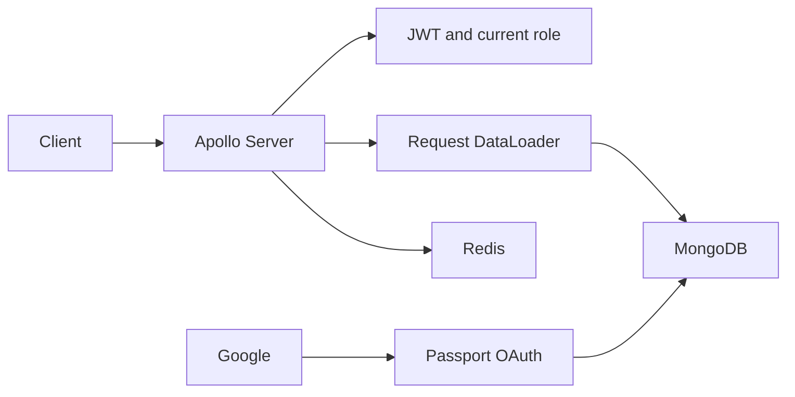

# GraphQL API Engine

[](https://github.com/yashybm30/graphql-api-engine/actions/workflows/ci.yml)

An ownership-aware notes API with MongoDB persistence, Google login and bounded queries.

## Implemented features

- Apollo Server schema with notes CRUD, paginated lists and owner-only access
- Google OAuth state validation with Redis sessions; verified-email requirement
- Signed JWTs and current database-role validation; admin-only users and statistics queries
- Request-scoped DataLoader author batching, input bounds and field-count validation
- Redis request rate limits, disabled HTTP batching and sanitized internal errors

## Architecture



Stack: Apollo Server 5, Node.js 24, MongoDB, TypeScript, DataLoader, Redis, Passport.js.

## Local setup

Requirements: Node.js 24, npm, Docker Engine with Compose v2. The HA cluster experiments additionally require kind, kubectl, metrics-server and k6. Examples use bash; set environment variables with the corresponding syntax in your shell.

```bash
cp .env.example .env
# Edit .env before starting. Use independent random secrets, never example values.
npm ci
npm run check
docker compose --env-file .env up --build -d
```

Run one portfolio stack at a time because development ports overlap. Docker Compose requires the CLI `--env-file` for values interpolated into configuration. For native execution, `npm start` reads `.env` automatically after `npm run build`.

## Configuration

| Variable | Purpose |
|---|---|
| `PORT` | HTTP port, default 3000 |
| `REDIS_URL` | Redis connection; localhost for native execution, service hostname in Compose |
| `JWT_SECRET` | Required random signing key, at least 48 characters |
| `GOOGLE_CLIENT_ID`, `GOOGLE_CLIENT_SECRET`, `GOOGLE_CALLBACK_URL` | Optional Google app credentials and registered callback |
| `SESSION_SECRET` | Independent random key of at least 48 characters when OAuth is enabled |
| `MONGO_URL` | MongoDB connection |
| `ADMIN_EMAILS` | Comma-separated verified Google emails allowed admin access |

## API usage

`POST /graphql` accepts a JSON `query` and standard GraphQL variables. Supply `Authorization: Bearer <accessToken>` obtained through `/auth/google` and its callback. Configure `ADMIN_EMAILS` to explicitly allow verified Google identities to access admin queries. Without OAuth configuration the API still starts, but production user onboarding is unavailable. Tests provision isolated identities directly in MongoDB.

```graphql
mutation { createNote(title: "Design review", body: "Review tenant boundaries") { id title } }
query { notes(page: 1, pageSize: 20) { items { id title author { name } } total } }
query { adminPanel { users notes } }
```

`notes`, `note`, `createNote` and `deleteNote` always scope by the authenticated owner. Admin queries do not bypass note ownership. `adminUsers` returns at most 100 users. Invalid or absent tokens produce GraphQL `UNAUTHENTICATED`; unauthorized admin queries produce `FORBIDDEN`. The schema bounds pagination to 100 items, fields to 100, and request bodies to 32 KiB. Redis permits 100 HTTP requests/minute per direct client IP, returning HTTP 429 afterward and HTTP 503 when the limiter is unavailable. `/health/live` and `/health/ready` are included in that global limit.

## Validation

```bash
npm run check              # lint, strict typecheck, unit/API tests, build
npm run test:integration   # real services must be running
npm run test:coverage      # combined unit + integration coverage; services required
```

Tests run the compiled application so NestJS decorator metadata matches production. Coverage includes compiled application code; bootstrap, external OAuth callbacks and telemetry initialization are excluded and require separate configured verification. Integration tests create isolated identities; they require disposable databases and must never target production.

Set `MONGO_URL` and `REDIS_URL`. The suite exercises persistence, owner isolation, member/admin boundaries, pagination bounds and author resolution. OAuth redirect/provider behavior needs a separate configured manual test.

## Deployment

Build the non-root image with `docker build -t graphql-api-engine:local .`. Compose is the supported local deployment. For GCP, publish the image to Artifact Registry and use Cloud Run or GKE with private database connectivity and secret injection; cloud resources and credentials are intentionally not provisioned. Configure TLS, network restrictions, resource budgets and graceful termination for the target environment.

## Security

See [SECURITY.md](SECURITY.md). Never commit `.env`; `.env.example` contains configuration examples only. Dependency scanning runs in CI. Database and Redis development ports bind localhost. No production cloud resources are changed by this project.

## Trade-offs and known limitations

The admin panel is a GraphQL query surface, not a browser dashboard. Google OAuth needs your provider credentials. There is no password login or token refresh; access expires after 15 minutes. CORS is not enabled, so cross-origin browser clients require an explicitly reviewed allowlist. Pagination uses offsets and caps pages; it does not promise snapshot consistency. MongoDB is a single local development node.

## Roadmap

Add a browser admin interface, cursor pagination, persisted queries, and OAuth provider integration tests.

MIT licensed. See [CONTRIBUTING.md](CONTRIBUTING.md) for the review workflow.
